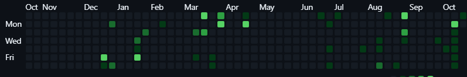

# Shavait Pandita — Personal Portfolio

<p align="center">
  
</p>

<p align="center">
  <b>Civil Engineering Undergraduate @ IIT Indore &bull; Practical AI &bull; High-Throughput Streaming &bull; Systems Design</b>
</p>

<p align="center">
  <a href="https://github.com/ershavait"></a>
  <a href="https://www.linkedin.com/in/shavait-pandita-2ab4b92a5"></a>
  <a href="https://leetcode.com/u/Shvait/"></a>
  <a href="https://codeforces.com/profile/Shvait"></a>
  <a href="mailto:ershavait@gmail.com"></a>
  
</p>

---

## ⛩️ Overview

A high-performance personal portfolio website inspired by the dark **Kyoto Night (Kage)** aesthetic. Built with real-time 3D WebGL rendering, falling sakura and maple leaf particle physics, custom shaders, and interactive audio-visual feedback.

---

## 🚀 Featured Projects

| Project | Tech Stack | Highlights | Links |
| :--- | :--- | :--- | :--- |
| **FlashGuard** | Pathway, XGBoost, Half-Space Trees, LangGraph, Redis, Kafka | Real-time streaming fraud detection pipeline executing online anomaly scoring in ~15–20 ms with live AML/KYC RAG. | [Source Code](https://github.com/sanchit1707/FraudDetectionUsingPathway) |
| **Tacotron2 + HiFi-GAN** | PyTorch, Tacotron2, HiFi-GAN, Accelerate, LJSpeech | End-to-end neural text-to-speech architecture with Conv1D+BiLSTM encoder, location-sensitive attention, and 256x convolutional upsampling vocoder. | [Source Code](https://github.com/ershavait/Tacotron2-TTS-) |
| **Cynaptics Mini-GPT** | PyTorch, Transformers, RoPE, Multi-Head Attention | ~10M parameter decoder-only transformer trained from scratch with Rotary Position Embeddings (RoPE), weight tying, and nucleus sampling. | [Source Code](https://github.com/ershavait/cynaptics-mini-gpt) |
| **InterviewAI** | JavaScript, Node.js, Express, LLMs, Full-Stack | AI-powered mock interview simulator with automated speech/code scoring and real-time candidate feedback. | [Live Demo](https://interviewai-hmc5.onrender.com/) &bull; [Source Code](https://github.com/ershavait/InterviewAI) |
| **Campus Ride-Sharing** | TypeScript, React, Node.js, Logistics, Tailwind | Ride-pooling coordination web platform engineered under DaemonLab for IIT Indore students and faculty. | [Source Code](https://github.com/DaemonLab/Ride-Sharing-Website) |

---

## 🛠️ Technical Arsenal

- **Languages**: Python, C++, TypeScript, JavaScript, SQL
- **AI & Deep Learning**: PyTorch, Transformers, Tacotron2, HiFi-GAN, XGBoost, Accelerate, Sequence Modeling
- **Streaming & Systems**: Pathway, Kafka, Redis, LangGraph, Vector Databases, Caching
- **Web & Infrastructure**: Node.js, Express, React, Vite, Three.js / WebGL, Docker, Linux, Git

---

## 🏆 Competitive Programming

- **Codeforces**: Maximum Rating **1315** &bull; Global Rank **2,683** among 32,000+ international contestants ([Profile @Shvait](https://codeforces.com/profile/Shvait)).
- **LeetCode**: **250+** algorithmic problems solved across Graph Theory, Dynamic Programming, and Advanced Trees ([Profile @Shvait](https://leetcode.com/u/Shvait/)).

---

## 🌟 Key Features of this Website

1. **Kyoto Night 3D Scene**: Custom Three.js renderer displaying real-time depth layers, ambient lantern glow, and particle weather systems.
2. **Interactive Direct Message Modal**: Visitors can drop notes via an obsidian glass modal delivering asynchronously to `ershavait@gmail.com`.
3. **Parallax Squeeze Transitions**: Hardware-accelerated CSS scroll-driven card-squeezing effect.
4. **Interactive Live Demos**: Direct links to production deployments.
5. **Resume Access**: Fast direct download for official resume (`Shavait_Pandita_Resume_InterIIT.pdf`).

---

## 💻 Local Development

```bash
# Clone the repository
git clone https://github.com/ershavait/Portfolio-Website.git

# Enter the directory
cd Portfolio-Website

# Install dependencies
npm install

# Start local dev server
npm run dev
```

Visit `http://localhost:5173/` or `http://localhost:5173/landing-pages/kage.html` in your browser.

### Production Build

```bash
npm run build
```

The compiled static assets will be ready in the `dist/` directory.

---

## 📬 Contact

- **Email**: [ershavait@gmail.com](mailto:ershavait@gmail.com)
- **LinkedIn**: [linkedin.com/in/shavait-pandita-2ab4b92a5](https://www.linkedin.com/in/shavait-pandita-2ab4b92a5)
- **GitHub**: [github.com/ershavait](https://github.com/ershavait)

---

<p align="center">
  &copy; 2026 Shavait Pandita &bull; All Rights Reserved
</p>
